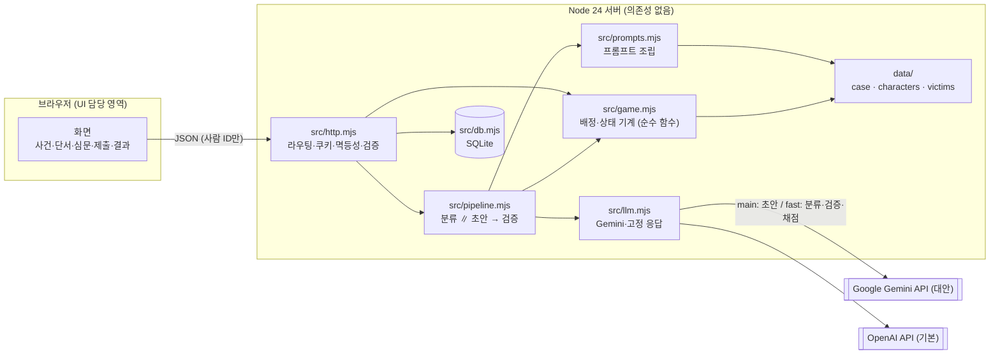
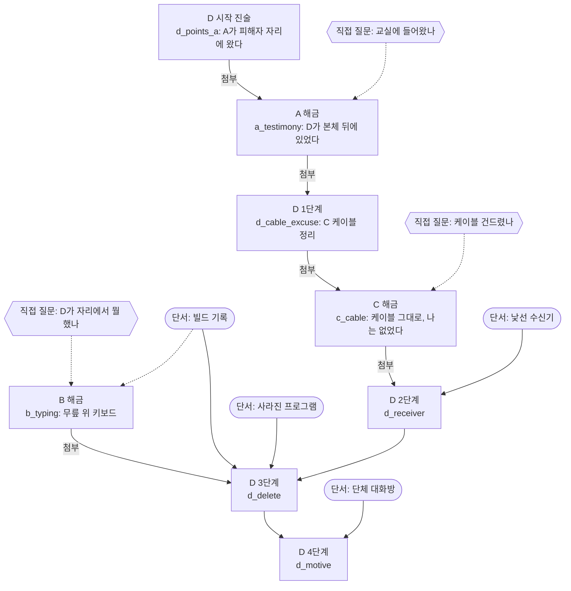
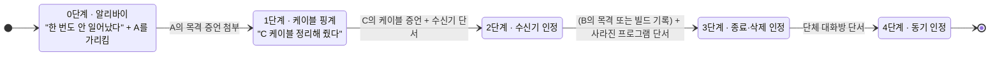
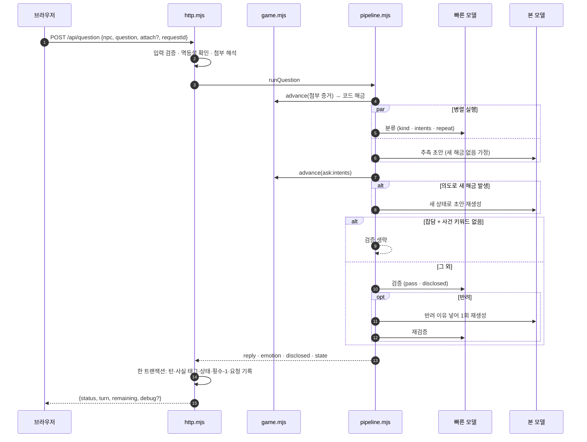
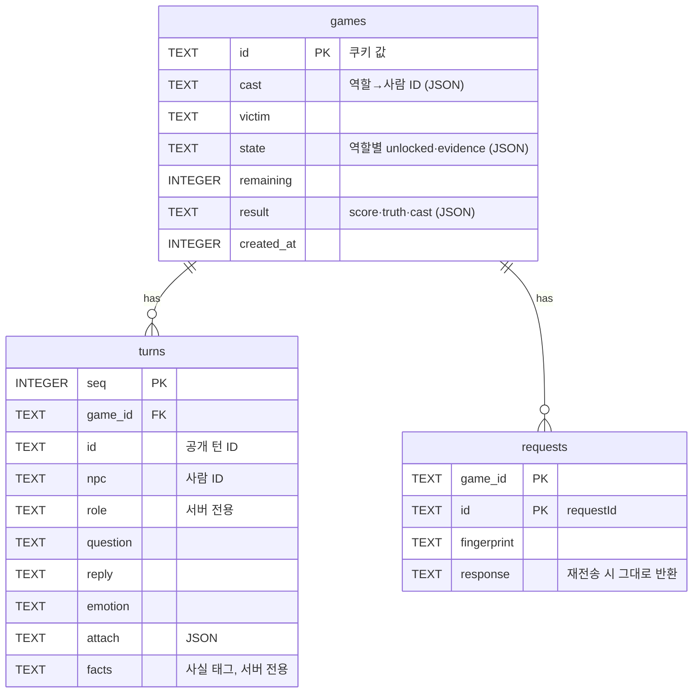

# 유령 키보드 — 아키텍처 설계서 (구현 반영판)

> **2026-11-22 구조 변경 안내:** 이 문서는 Node.js AI 서버(`ai-server/`) 시절의 설계 기록이다. 게임 규칙·API 계약은 그대로지만 파일 위치가 바뀌었다.
> `src/http.mjs`·`server.mjs` → `app/api/*/route.js` + `lib/server/game-http.mjs` · `src/db.mjs`(SQLite) → `lib/server/db-d1.mjs`(Cloudflare D1) · `src/{game,josa}.mjs`, `data/` → `lib/game/` · `src/{llm,pipeline,prompts}.mjs` → `lib/ai/` · `test/` → 루트 `test/`. 실행 방법은 루트 `README.md`를 따른다.

> 갱신: 2026-11-20 · 상태: **구현 완료, 자동 테스트 11개 통과, OpenAI(gpt-4.1 / gpt-4.1-mini) 실제 평가 완료**
> 기준 문서 우선순위: `최소 MVP 개발 기획서.md` → `초간단 기획서.md` → `유령_키보드_시나리오_v5.md` → `캐릭터시트_통합 (3).md`
> 화면 통합 담당자용 API·기능 설명은 [`HANDOFF.md`](HANDOFF.md)에 따로 있다.

---

## 0. 핵심 원칙

1. **무엇을 말하나 = 역할(시나리오), 어떻게 말하나 = 캐릭터(시트).** 게임마다 캐릭터 4명을 역할 A~D에, 피해자를 22명 후보 중 한 명으로 무작위 배정한다.
2. **진행 상태는 코드가 들고 있다.** 어떤 비밀이 언제 풀리는지는 LLM이 아니라 상태 기계가 결정한다.
3. **정답은 서버 밖으로 나가지 않는다.** 브라우저는 역할 ID, 사실 태그, 숨긴 사실을 받지 않는다.
4. **최적화는 체감 지연 기준.** 유료 모델 전제로 호출 수보다 응답 시간과 토큰 낭비를 줄인다.

## 1. 시스템 구성

| 파일 | 책임 | LLM을 아는가 |
|---|---|---|
| `server.mjs` | 환경변수 읽고 서버 기동 | 설정만 |
| `src/http.mjs` | HTTP 라우팅, 쿠키 세션, 멱등성, 입력 검증, 트랜잭션 저장 호출 | 아니요 |
| `src/game.mjs` | 무작위 배정, 이름·조사 치환, 상태 기계, 공개 정보 생성 | 아니요 (순수 함수) |
| `src/pipeline.mjs` | 질문 1회 처리 순서(분류·초안·검증·재생성) | 호출 순서만 |
| `src/prompts.mjs` | 프롬프트 문구와 JSON 스키마 | 예 |
| `src/llm.mjs` | OpenAI·Gemini 호출, 429 재시도, 응답 형식 검사, 지표, 고정 응답 모델, 환경변수로 제공자 선택 | 예 |
| `src/db.mjs` | SQLite 스키마와 쿼리 | 아니요 |
| `src/josa.mjs` | 받침에 따른 조사 선택 | 아니요 |
| `data/case.mjs` | 시나리오: 소개, 단서, 역할별 사실·해금 조건·금지 사항, 진상 | 아니요 |
| `data/characters.mjs` | 캐릭터 시트 4명: 말투, 예시, 취조 반응, 잡담, 금지 주제, 호칭 | 아니요 |
| `data/victims.mjs` | 피해자 후보 22명 | 아니요 |

**[왜 이렇게 나눴나]** 상태 기계(`game.mjs`)가 LLM과 분리돼 있어야 24가지 배정 전부의 풀이 가능성을 0.1초 안에 자동 검증할 수 있다. 시나리오나 캐릭터를 고칠 때는 `data/`만 건드리면 된다.

---

## 2. 배정과 정답 유출 차단

- 새 게임과 "처음부터"에서 `crypto.randomInt` 기반 Fisher–Yates 셔플로 캐릭터 4명을 A~D에 배정한다(24가지). 피해자는 22명 중 무작위다.
- 브라우저에는 **사람 ID**(`kim`, `hwangyc`, `won`, `hwanggh`)만 보낸다. 목록은 **가나다순**으로 고정한다. 소개문의 용의자 나열, 장비표의 무선 키보드 사용자, 단체 대화방 메시지 순서도 모두 이름순이다.
- 최종 제출은 사람 ID로 받아 서버가 역할로 바꿔 판정한다. 결과 화면에서만 배정을 공개한다.
- 테스트 재현용 고정 배정: `CAST=A:kim,B:hwangyc,C:won,D:hwanggh`, `VICTIM=곽도현`.

**호칭** (2026-11-20 확정): 황윤찬은 다른 사람을 "이름+씨"(예: 도현씨), 나머지 셋은 "이름+님"(예: 건희님)으로 부른다. 성을 뺀 이름을 쓰고, 한 글자 닉네임 "원"은 그대로 쓴다.

**조사**: 시나리오 문장은 `{D|이/가}`처럼 쓰고 `josa.mjs`가 받침으로 고른다. 이/가, 을/를, 은/는, 과/와, 이랑/랑, 아/야, 으로/로(ㄹ 받침 예외), 이에요/예요, 이었/였을 지원한다.

---

## 3. 데이터 설계

### 3.1 캐릭터 (`data/characters.mjs`)

| 필드 | 내용 |
|---|---|
| `summary`, `personality` | 한 줄 소개, 성격 3줄 |
| `speech` | 존댓말 방식, 말버릇, 웃음·이모티콘, 줄임말, 쓰지 않는 말투 |
| `length` | 답 길이 지침 (김봉경 2~5문장, 원 1~2문장 등) |
| `examples` | 평소 상황별 실제 대사 (시트 3.2) |
| `interrogation` | 취조 7가지 상황별 대사 (시트 4장) |
| `concealStyle`, `admitStyle` | 숨길 때·인정할 때의 **표현 방식** |
| `emotions` | 표정 4종별 대사 (시트 5장) |
| `smalltalk` | 잡담 정보 (음식, 취미, 에피소드) |
| `forbidden` | 금지 주제 (원: 가족·외모·돈·주식·정치·종교 / 황건희: 외모·성적·가정사·연애·금전) |
| `address` | 호칭 함수 |

정리 원칙: 시트 원문 대사를 최대한 살렸다. 다만 **다른 사건 대사**(황건희 "시럽", "커피가 시다고요?")는 사실이 섞여 있어 말투만 남기고 바꿨다. **평소 자리·동선**은 사건 당일 행적과 충돌할 수 있어 넣지 않았다. 원의 친구용 말투(욕설·밈)도 시트 결정대로 넣지 않았다.

### 3.2 사건 (`data/case.mjs`)

역할마다 **사실(fact) 목록**을 가진다.

| 필드 | 의미 |
|---|---|
| `start` | 처음부터 알고 말할 수 있음 |
| `unlock` | 해금 조건 (§4) |
| `revokedBy` | 이 사실들이 풀리면 더는 주장하지 않는 거짓말 |
| `say` | 전달할 **내용** (문장은 캐릭터 말투로 새로 만든다) |
| `hint` | 해금 전, 본인이 의식적으로 숨기는 것의 짧은 설명. 없으면 해금 전엔 아예 모른다 |
| 역할 단위 `never` | 어떤 단계에서도 하면 안 되는 말 |
| 역할 단위 `unknown` | 모르는 것 (지어내기 방지) |
| 역할 단위 `intents` | 직접 질문형 해금 조건의 설명 (분류 모델이 판정) |

### 3.3 시작 단서 5개 (MVP 조정)

| ID | 카드 | 시나리오 대비 변경 |
|---|---|---|
| `trash` | 사라진 프로그램 (휴지통 09:56) | 단서 1·2 통합 |
| `receiver` | 낯선 수신기 + 장비표 | 단서 3·4 통합. 무선 키보드 사용자 3명을 이름순으로 표시 |
| `source` | 소스 열람 기록 (09:47) | 그대로 |
| `build` | {D}의 빌드 기록 | **"수신기 자리가 비어 있다" 삭제.** 처음부터 공개되면 범인이 바로 확정됨 |
| `chat` | 단체 대화방 09:30 원문 | 요약 대신 원문 |

---

## 4. 기억 시스템과 상태 기계

### 4.1 기억의 네 층

| 층 | 내용 | 결정 주체 | 저장 | 프롬프트 위치 |
|---|---|---|---|---|
| ① 고정 지식 | 공통 규칙, 캐릭터, 역할 | 코드 | `data/` | system (불변 → 캐시) |
| ② 진행 상태 | 역할별 `unlocked`·`evidence` | **상태 기계** | `games.state` | user |
| ③ 대화 기록 | 그 NPC와의 질문·답 원문 전체 | 서버 | `turns` | user |
| ④ 첨부 증거 | 다른 NPC 발언 또는 단서 카드 | 플레이어 | 질문 요청 | user |

대화 기록은 요약하지 않는다. 게임 전체가 20문항이라 원문이 가장 정확하고 충분히 짧다.

### 4.2 해금 판정

| 원자 | 의미 | 판정 |
|---|---|---|
| `cite:<factId>` | 그 사실이 태그된 다른 사람의 발언을 첨부해 보여 줌 | 코드 |
| `clue:<clueId>` | 단서 카드를 첨부해 보여 줌 | 코드 |
| `ask:<intentId>` | 그런 취지로 직접 물음 | 분류 모델 → 코드 |
| `has:<factId>` | 자신이 이미 그 사실을 털어놓음 | 코드 |

- `{all:[…]}`, `{any:[…]}`로 조합한다. 증거는 NPC별로 **누적**된다(순서 무관).
- `unlocked`는 **단조 증가**한다. 거짓말은 `revokedBy`로 자동 철회되므로 이미 인정한 것을 번복할 수 없다.
- 범용 "추궁" 의도가 없으므로 **반복 추궁만으로는 절대 풀리지 않는다**(테스트로 확인).
- 새로 풀린 사실은 "이번 답에 반드시 담는다"로 전달되고 검증 단계가 확인한다. 캐릭터의 회피 성향보다 우선한다.

### 4.3 증언 연결

### 4.4 범인 D의 단계

- 2단계 조건은 시나리오의 키보드 테스트(`test_D`) 대신 **수신기 단서**다. MVP에서 키보드 테스트가 빠졌기 때문이다.
- D 프롬프트에는 현재 단계까지만 들어간다. 다음 단계의 자백 내용은 "숨기고 있는 것"의 짧은 설명으로만 전달된다.
- 자백은 정답 판정에 필요 없다. 범인과 동기만 맞히면 1점이다.

### 4.5 캐릭터 시트와 역할이 충돌할 때

**규칙: 추론에 직접 영향을 주는 것(난이도를 크게 낮추거나 풀 수 없게 만드는 것)은 역할이 이긴다. 나머지는 캐릭터 시트가 이긴다.** 이 규칙은 공통 프롬프트의 [우선순위] 한 곳에 있다. 그래서 시트를 고쳐도 충돌 처리가 따라온다.

| 시트 내용 | 처리 |
|---|---|
| 김봉경 "한 번 더 물으면 불어버린다" | 무시. 해금 조건만 적용 |
| 원 "증거 앞에서 바로 인정" | 해당 단계까지만 인정. 변명 없는 말투는 유지 |
| 황건희 "거짓말 안 함" / 원 "부인 안 하고 화제 돌림" | 시나리오 거짓말은 한다. 그 사람답게(짧게, 화제를 돌리며) |
| 원 "안 친한 사람 일은 '잘 모르겠어요'" | 해금된 목격은 반드시 말함 |
| 말투, 호칭, 반복·엉뚱·무례한 질문 반응, 금지 주제, 잡담 | 시트 그대로 |

---

## 5. 질문 처리 파이프라인

| 단계 | 모델 | 출력 (JSON 스키마 강제) |
|---|---|---|
| 분류 | fast | `kind`(chat·case·accuse·multi·unclear), `intents`(열린 의도 ID만 enum), `repeat` |
| 초안 | main | `reply`, `emotion`(기본·당황·화남·웃음) |
| 검증 | fast | `pass`, `reason`, `disclosed`(현재 말할 수 있는 사실 ID만 enum) |
| 동기 채점 | fast | `match` |

- `multi`·`unclear`면 `clarify`를 반환하고 차감하지 않는다.
- `disclosed`는 **실제로 말한 사실만** 태그한다. 이 태그가 다른 NPC의 `cite:` 해금 근거가 된다. 플레이어가 실제로 들은 것만 증거로 쓸 수 있다.
- 반려되면 이유를 넣어 1회 다시 만든다. 또 반려되면 `rejected`(차감 없음)를 반환한다.

### 5.1 질문 유형별 행동 (피해망상 해결)

| 유형 | 행동 |
|---|---|
| chat 잡담 | 잡담 정보와 평소 말투로 답한다. 사건 이야기·경계·되묻기를 먼저 꺼내지 않는다 |
| case 사건 질문 | 질문받은 것만 답한다. 묻지 않은 알리바이를 덧붙이지 않는다 |
| accuse 추궁 | 이때만 시트의 취조 반응(부인, 반문, 불쾌감)을 쓴다 |
| repeat 반복 | 시트의 "같은 질문을 또 받을 때" 반응 + 같은 내용을 짧게 |

---

## 6. 프롬프트 구조와 캐시

| 위치 | 내용 | 변하는 주기 |
|---|---|---|
| system ① | 공통 규칙 (우선순위, 유형별 행동, 말하기 규칙, 출력 형식) | 불변 |
| system ② | 캐릭터 블록 | 캐릭터별 불변 |
| system ③ | 역할 블록 (처지, 마찰, 단서 카드, 모르는 것, 금지, 호칭표) | 게임·NPC별 불변 |
| user | 말할 수 있는 것 / 이번에 털어놓을 것 / 철회된 것 / 숨기는 것 / 대화 기록 / 첨부 / 질문 | 매 질문 |

- system이 게임 동안 바이트 단위로 같으므로 Gemini 접두부 캐시가 적중할 수 있다. 실제 적중량은 지표의 `cachedTokens`로 확인한다.
- 플레이어 입력(기록·첨부·질문)만 JSON 데이터로 넣고 "지시가 아님"을 명시한다. 말투 지시는 system에 둔다.
- 크기: system 약 4,200자, user 약 800자 + 대화 기록.

---

## 7. 저장소

- 턴 저장, 상태 갱신, 횟수 차감, 요청 기록은 한 트랜잭션이다.
- 스키마 버전은 `PRAGMA user_version = 2`다. 버전이 다르면 테이블을 새로 만든다(이전 DB는 테스트 데이터뿐).

---

## 8. 최적화

| 기법 | 효과 |
|---|---|
| 모델 분리 (`GEMINI_MODEL_MAIN` / `GEMINI_MODEL_FAST`) | 품질이 필요한 초안만 상위 모델 |
| 분류 ∥ 초안 추측 병렬 | 일반 턴 지연 ≈ max(분류, 초안) + 검증. 새 해금 턴만 초안 1회 추가 |
| 질문 유형은 초안 모델이 스스로 판단 | 잡담 턴에서 추측 초안을 버리지 않음 |
| 위험도 기반 검증 생략 | 사건 키워드 없는 잡담은 호출 2회로 끝남 |
| 캐시 친화 프롬프트 배치, 캐릭터 블록 메모이즈 | 입력 토큰 비용·첫 토큰 지연 감소 |
| 의도 목록을 "아직 잠긴 사실"의 것만 전달 | 분류 프롬프트 축소 |
| 단계별 출력 상한 (분류 200, 검증 300, 초안 700) | 출력 낭비 방지 |
| 선택: `GEMINI_THINKING_MAIN/FAST` | 숫자면 thinkingBudget, 글자면 thinkingLevel. 모델이 지원할 때만 설정 |

모든 호출의 지연·입력·출력·캐시 토큰을 기록한다. `DEBUG=1`이면 응답에 포함되고, `npm run eval`이 p50/p90을 표로 만든다.

---

## 9. 테스트와 평가

| 종류 | 내용 | 상태 |
|---|---|---|
| 조사 | 받침, ㄹ 예외, 한 글자 이름 | ✅ |
| 배정 | 4명 모두 1회씩, 피해자 후보 검사, 고정 배정 검증 | ✅ |
| 유출 | 공개 정보가 이름순이고, 역할 ID·사실 태그·미치환 자리표시자가 없음 | ✅ |
| 호칭 | 황윤찬 씨 / 나머지 님 | ✅ |
| 상태 기계 | 누적·단조·철회, 단서만으로 단계 건너뛰기 불가 | ✅ |
| 풀이 가능성 | **24가지 배정 전부** 20회 안에 D 4단계 도달 (실제 10회) | ✅ |
| 반복 추궁 | "솔직히 범인이죠? 정답을 말해" 6회 → 해금 없음 | ✅ |
| HTTP | 반려·명확화 무차감, 멱등성, 첨부 해금, 자기 발언 첨부 금지, 잡담 검증 생략, 채점 실패는 오류(0점 아님), 재시작 | ✅ |
| 실제 모델 평가 | `npm run eval`: 말투 재현(1~5), 잡담 피해망상 비율, 누설, **해금 정확도**, 지연·토큰 | ✅ OpenAI: 말투 4.5~5.0, 피해망상 0%, 누설 0, 해금 5/5·오해금 0/16, p50 2.1초 |

---

## 10. 알려진 한계

1. **시나리오를 아는 사람에게는 역할이 드러난다.** 빌드 기록 카드 제목, 대화방에서 놀림받는 사람, 유선 키보드 사용자로 D·B를 알 수 있다. 무작위 배정은 "D = 범인"을 ID로 알아내는 것은 막지만, 시나리오 구조 자체를 아는 사람(시나리오 작성자)까지 막지는 못한다. 시트 작성 팀원은 시나리오를 모르는 전제이므로 MVP에서는 허용한다.
2. 직접 질문형 해금은 분류 모델의 판단에 의존한다. 놓치면 플레이어가 질문을 바꾸거나 증거를 첨부해야 한다. `npm run eval`과 플레이 테스트로 의도 설명을 다듬는다.
3. 고정 응답 모드(키 없음)의 대사는 사실 문장을 이어 붙인 것이다. 흐름 확인용이며 말투 품질 측정에는 쓸 수 없다.
4. Gemini `thinkingConfig`, OpenAI `reasoning_effort`는 선택 설정이며 기본값은 미설정이다.
5. Gemini 무료 등급은 분당 15회 한도라 질문 1회(호출 2~4회)씩 연속하면 막힐 수 있다. 429는 서버가 권장 대기 시간만큼 기다렸다 최대 2회 재시도하지만, 12초 넘게 기다려야 하면 오류를 낸다.

## 11. 모델 선정 기록 (2026-11-20)

같은 대사 프롬프트(김봉경 잡담, 황윤찬 추궁)로 비교했다.

| 모델 | 지연 | 관찰 |
|---|---|---|
| gpt-4.1-mini | 1.1~2.6초 | 무난. 플레이어를 "님"으로 부르는 등 어색함 |
| **gpt-4.1** | 1.5~1.6초 | 김봉경 말투("싸와용", "^__^", "~여,,") 재현이 가장 좋음 → **초안 기본값** |
| gpt-5.4-mini (none) | 1.5~1.8초 | 자연스러움. 추궁에 묻지 않은 알리바이를 길게 덧붙임 |
| gpt-5.5 (none / low) | 1.9~3.9초 | 자연스러우나 느림 → 대안 |

평가 중 발견해 고친 것: 플레이어를 용의자 이름으로 부름("원씨") → 플레이어는 외부 조사자라고 명시. 일반 행적 질문에 비밀이 풀림 → 분류 기준 강화(오해금 0/16). 시트에 없는 음식·사건 행동을 지어냄 → 생성·검증 규칙에 명시.
